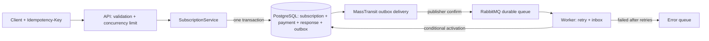

# Subscription Billing

ASP.NET Core backend: запись оплаты, создание подписки и асинхронная активация.
PostgreSQL 16 · RabbitMQ 4 · EF Core 8 · MassTransit 8 · .NET 8.

## Запуск

Нужен Docker с Compose. Из корня репозитория:

```sh
docker compose up --build -d
```

Открой [Swagger](http://localhost:8080/swagger). Compose запускает БД, брокер,
миграции, API и worker. Первая сборка скачивает образы. Данные сохраняются в volumes.
Остановка: `docker compose down`. Локальные пароли заданы в Compose;
их можно заменить через `.env` (`POSTGRES_PASSWORD`, `RABBITMQ_PASSWORD`).

## Архитектура



- **Деньги и событие атомарны:** outbox записывается в той же транзакции.
  При недоступном брокере запрос сохраняется, доставка продолжится после восстановления.
- **Параллельные повторы безопасны:** PostgreSQL advisory lock по ключу,
  сохранённый ответ, `409` при смене тела. Нет блокировок в памяти одного сервера.
- **Доставка at-least-once:** inbox и условный UPDATE защищают активацию от дублей.
  Необработанные события после трёх повторов попадают в `subscription-activation_error`.
- **Контроль нагрузки:** максимум 64 одновременных API-запроса, затем `429`;
  prefetch 32, 8 обработчиков на worker; индекс и cursor pagination с лимитом 100.
- **Эксплуатация:** отдельные API/worker, миграции перед запуском, контейнер без root,
  JSON-логи, `traceId` в ProblemDetails, `/health/live` и `/health/ready`.

## Попробовать

1. `POST /api/users`: `{"name":"Stepan","email":"stepan@example.com"}`.
2. `POST /api/subscriptions/create`: `{"userId":1,"plan":"basic"}`,
   заголовок `Idempotency-Key: 75be42df-1323-48c2-a317-55bb64445a1b`.
3. Ответ `202` и `Location`; `GET /api/subscriptions/1` покажет `isActive: true`
   после обработки события. Повтор шага 2 вернёт исходный ответ без второй оплаты.

Цены задаёт сервер: basic = 990 RUB, pro = 1990 RUB. Список:
`GET /api/subscriptions?userId=1&afterId=0&limit=20`. Полный контракт в Swagger.

## Проверка

```sh
docker compose --profile test run --build --rm tests
```

xUnit + WebApplicationFactory проверяют настоящий PostgreSQL и RabbitMQ:
20 параллельных повторов, откат после вставки платежа, конфликт ключа,
валидацию, серверную цену, пагинацию, дубли событий и активацию.
Тесты используют отдельную БД `billing_tests` и отдельный exchange/queue.

`pwsh ./scripts/verify.ps1` проверяет полный стек, отключает брокер,
перезапускает API и проверяет доставку сохранённого события после восстановления.
GitHub Actions запускает обе проверки. [Архитектурные решения и масштабирование](docs/architecture.md).

Мини-бенчмарк записи (Python 3, без пакетов):
`python scripts/load.py --requests 200 --concurrency 20`.
Он измеряет p50/p95 и число принятых запросов в секунду, затем проверяет активацию.
[Результат проверок и условия замера](docs/verification.md).

## Границы проекта

Это демонстрация надёжности backend, оплата симулируется: платёжного провайдера,
авторизации, возвратов и периодических списаний пока нет. Compose открыт только
на localhost. Для публичного сервиса нужны auth, проверенные webhooks провайдера,
TLS и управление секретами. Высокая нагрузка требует замеров, а не обещаний RPS.

Контракт изменён: клиентский `amount` удалён, POST теперь возвращает `202`.
Начальная миграция предназначена для новой БД; старую БД, созданную через
`EnsureCreated`, нужно переносить отдельно с резервной копией.
