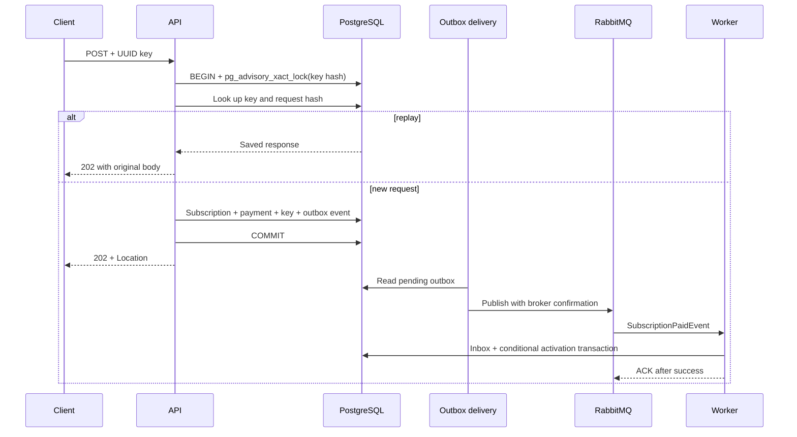

# Архитектурные решения

## Границы и зависимости

Один небольшой кодовый модуль, два процесса с разными ролями. Контроллеры отвечают
за HTTP и DTO, SubscriptionService за бизнес-транзакцию, EF Core за хранение,
consumer за асинхронную активацию. API и worker используют одну схему БД.
Это осознанный компромисс: нет распределённой транзакции и лишних сетевых вызовов,
но процессы связаны схемой и требуют совместимых изменений при развёртывании.

`ServiceRole=Api|Worker|All|Migrate` определяет роль. Compose использует первые
два для работы и отдельный одноразовый Migrate. Автоматических миграций на каждом
API-экземпляре нет. Generic repository поверх EF Core не добавлен: он скрыл бы
транзакцию и запросы без полезной новой границы.

Для новой миграции из корня: `dotnet tool restore`, затем
`dotnet ef migrations add Name --project "Subscription & Billing"`.
Изменение схемы проверяется на новой БД и оформляется совместимо с rolling deployment.

## Денежная транзакция

Цена берётся из каталога сервера. PostgreSQL хранит decimal(18,2), проверяет
положительную сумму и уникальность payment.subscriptionId. User FK защищает
ссылочную целостность. Ответ и отпечаток запроса сохраняются вместе с оплатой.
Advisory lock живёт до конца транзакции, одинаково работает на разных API-репликах.
Коллизия 64-битного хеша замедлит два разных ключа, но не смешает их данные.

Ключи не удаляются автоматически: в демонстрации гарантия повторов не имеет TTL.
В production retention нужно согласовать с периодом клиентских повторов и аудитом.
Ключ сейчас глобальный; после добавления auth его область должна включать tenant
и операцию. Чтение GET возвращает текущий статус, POST replay возвращает сохранённый.
Это позволяет безопасно повторить запрос после неизвестного результата COMMIT.

## Отказы

| Сбой | Результат |
|---|---|
| Ошибка до COMMIT | Вся транзакция откатывается, тот же ключ можно повторить |
| Ответ потерян после COMMIT | Повтор возвращает сохранённый ответ и ID |
| Брокер недоступен | Событие остаётся в outbox, активация отложена |
| Процесс API остановлен | Pending outbox остаётся в PostgreSQL |
| Worker остановлен | Durable queue накапливает события |
| Worker умер после UPDATE до ACK | Повторная доставка безопасна благодаря inbox и условному UPDATE |
| Несогласованное событие | Три retry, затем error queue; требуется расследование и redrive |

Outbox не обещает exactly-once транспорт. Inbox отсеивает повторные message IDs,
а условный UPDATE защищает от того же бизнес-события с новым message ID.
Нельзя автоматически расширять это утверждение на внешние побочные эффекты,
например выдачу лицензии сторонним HTTP-сервисом: ему тоже нужна идемпотентность.

Используется [EF transactional outbox MassTransit](https://masstransit.io/documentation/configuration/middleware/outbox)
и [transaction-scoped advisory lock PostgreSQL](https://www.postgresql.org/docs/16/functions-admin.html#FUNCTIONS-ADVISORY-LOCKS).
Версия MassTransit 8.3.6 выбрана с зависимостями EF Core 8.

## Масштабирование и наблюдение

- `docker compose up -d --scale worker=3` добавляет competing consumers одной очереди.
  Это повышает параллелизм, но требует контроля соединений БД и нагрузки на PostgreSQL.
- API не хранит сессии или ключи в памяти. Несколько API за балансировщиком
  используют общую БД; текущий Compose публикует фиксированный порт одного API.
- Concurrency limiter даёт backpressure и `429`, но не является общей квотой
  пользователя или распределённым rate limiter. Клиент повторяет с backoff и тем же ключом.
- Список читает только DTO, без tracking, использует keyset вместо OFFSET.
  Кеш не добавлен: stale состояние активации усложнило бы денежный сценарий.
- Очереди и outbox конечны по ресурсам. Нужны алерты на возраст/число outbox,
  глубину очереди, error queue, latency, 429/5xx, CPU и соединения БД.
  RabbitMQ UI доступен на localhost:15672; JSON-логи показывают ID подписки и ключ.
- `/health/live` отвечает за процесс; `/health/ready` у API проверяет БД и остаётся
  успешным при сбое брокера: запись сохраняется в outbox. У worker readiness также
  проверяет MassTransit, так как обработка событий требует брокер.

Нагрузочную ёмкость измеряют отдельно на оговорённом железе. Для теста записи нужны
разные ключи и пользователи, иначе будет измеряться replay или сериализация одного
ключа. Настройки 64/32/8 являются исходными ограничениями, а не доказанной ёмкостью.

## Проверяемость

Интеграционные тесты стартуют HTTP host через WebApplicationFactory, применяют
миграции к отдельной PostgreSQL БД и используют отдельную топологию RabbitMQ.
Инъекция ошибки во второй SaveChanges проверяет откат уже вставленной оплаты.
Smoke-скрипт проверяет отказ брокера и перезапуск процесса на реальных контейнерах.
Тесты не используют EF InMemory и не подменяют брокер заглушкой.

Старый пароль удалён из конфигурации; Git history сохраняет прошлые версии.
Если он использовался где-либо вне локального примера, его необходимо сменить.
